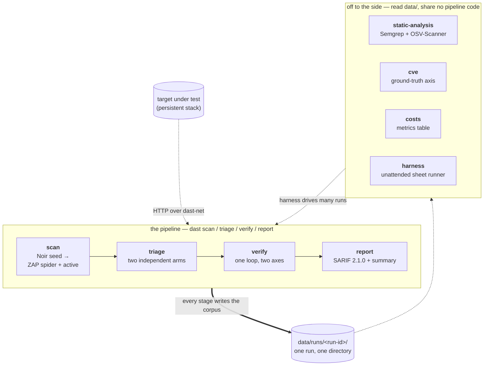
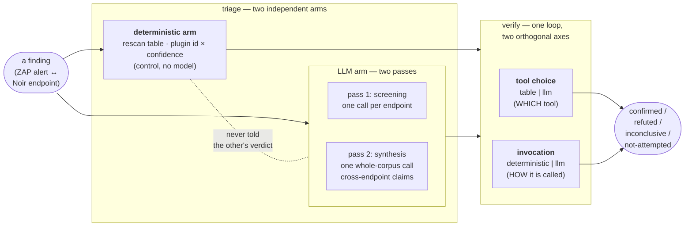
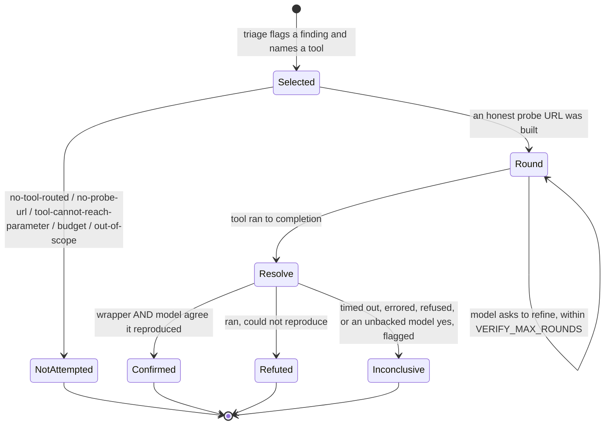
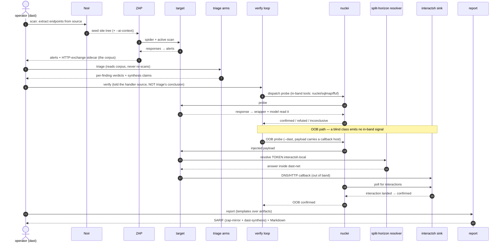
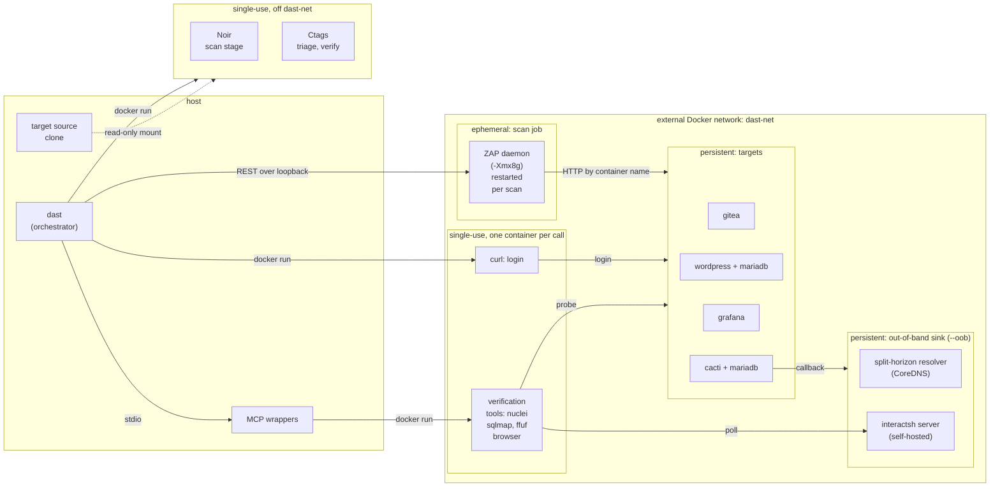

# Architecture

The conceptual overview of the tool: the **vocabulary**, the pipeline, the
layered source structure, and the data flow — how the pieces fit and *why* the
shape. The companion references, which it points into rather than repeats, are:

- [`OUTCOMES.md`](OUTCOMES.md) — every status a finding can carry, per stage, and
  what it resolves to.
- [`DETECTABILITY.md`](DETECTABILITY.md) — what counts as a detected vulnerability:
  detectability is MEASURED per run (reach × observe → outcome), never asserted,
  and the blind-vs-`--oracle` ladder is a two-run comparison.
- [`TARGETS.md`](TARGETS.md) — how a target is defined: every `target.yml` field
  and what it changes.
- [`COMMANDS.md`](COMMANDS.md) and [`api/`](api/) — the generated command, flag and
  per-module references.

## What it is

A pipeline that combines **OWASP ZAP** (DAST) with an AI **triage/verification**
layer and emits a **SARIF 2.1.0** report plus a human summary. It runs entirely
locally in Docker on an arm64 laptop; every image is pinned arm64-native. One
console script, `dast`, drives every stage. It is the practical artifact for the
thesis *"DAST in CI/CD Pipelines — A Case Study on Security Evaluation."*

The tool's categories are deliberately distinct, and much of its design turns on
not conflating them, so the vocabulary is defined first.

## The vocabulary

The words below are used precisely and consistently across the code, the docs and
the thesis. Where two look like synonyms, they are not; the distinction is
deliberate.

**stage** — one of the four pipeline steps, each its own `dast` subcommand and its
own process: `scan`, `triage`, `verify`, `report`. A *stage* is not a *phase*
(a phase is a labelled section of a log) and not a *Phase N* (a development
milestone, kept only as history).

**corpus** — what a `scan` produces: the raw alerts plus the HTTP-exchange
sidecar. It is the expensive, target-facing artifact; every downstream number is
computed *over* a corpus. Re-triaging or re-verifying the same corpus with a
different model is a **variant of the same corpus**, told apart by an artifact
**suffix**, not by a new scan. A promoted, frozen corpus is a **baseline**.

**the two triage arms** — triage judges each finding twice, independently: the
**deterministic arm** (a rescan lookup table keyed on ZAP plugin id × confidence —
the control, no model) and the **LLM arm**. The arms are kept independent — the
LLM arm is *never* told what the table decided — because their agreement is the
experiment, and an arm that sees the other's verdict makes every agreement count
circular.

**the LLM arm's two passes** — **screening** (pass 1, one call per endpoint,
rescan verdicts only) and **synthesis** (pass 2, one *whole-corpus* call,
cross-endpoint findings only). The passes must not collapse into one: pass 1 is
per-endpoint, pass 2 is deliberately global and is never chunked.

**synthesis claim** — a pass-2 finding that spans endpoints and is tied to no
single ZAP alert (e.g. "this weakness propagates across a route family"). It lives
in its own `c-` id space and carries a **disposition** (its `suggested_tool`) that
decides how it may ever be settled — a real tool, `self-evident`, or
`out-of-scope`. In the SARIF report these surface under the `dast-synthesis`
namespace (see [Reports](#reports-and-the-two-sarif-namespaces)).

**verification's two axes** — verify is **one** bounded loop with **two
orthogonal** knobs: **tool choice** (`table` | `llm`) picks *which* tool settles a
finding, and **invocation** (`table`'s reading vs the model's — `deterministic` |
`llm`) picks *how* the tool is called and when to stop asking. The default is
`table`/`llm`: the two arms name the same tool ~96% of the time, so the free
lookup is the sensible chooser, while *invocation* is the axis that actually moves
verdicts.

**verdict vs outcome** — a **verdict** is a *named reader's* judgment
(`wrapper_verdict`, `llm_verdict`, `reported_verdict`, combined by
`resolve_verdict`). An **outcome** is the canonical four-state result of
verification (`confirmed` / `refuted` / `inconclusive` / `not-attempted`). The two
are distinct throughout the code and are not interchangeable.

**push vs pull (retrieval)** — how evidence reaches a model. **push** (the
default and the A/B baseline) assembles the evidence pack once and hands it over;
**pull** replaces the bulky parts with manifests and lets the model fetch what it
wants from a read-only context server. One prompt serves both, so retrieval is the
only variable in the comparison.

**blind vs the `--oracle` ceiling** — a **blind** run is the real deliverable: the
pipeline is told nothing about the target's known vulnerabilities. The
**`--oracle` ceiling** hands the pipeline the answer key (the weakness, file,
parameter, sink) and measures *how far it could get if triage were perfect*. The
ceiling is **never a detection rate**, never shares a table with a blind run, and
never shows a model `cve-markers.yml`. The **blind → ceiling gap** separates
"undetectable in principle" from "detectable but missed" — `dast cve` measures each
run's per-marker outcome and prints the two-run ladder (see
[`DETECTABILITY.md`](DETECTABILITY.md)).

**OOB confirmation** — out-of-band confirmation. A **blind** vulnerability class
(e.g. blind command injection) produces no in-band signal for any DAST engine to
detect, so it is confirmed only by a callback that arrives *out of band* — a probe
injects a payload that makes the target call home to a self-hosted **interactsh**
sink through a **split-horizon resolver**. It confirms *exploitability*, and is a
**separate axis** from in-band detection (see
[The OOB confirmation path](#the-oob-confirmation-path)).

**static-analysis findings** — the standalone SAST + SCA outputs (Semgrep +
OSV-Scanner). They run against the target's *source repo*, emit SARIF, and share
**no** code with the DAST pipeline. They are a comparison axis, never a feedback
loop into DAST.

**systemic collapse** — triage folds a protection that is missing across a whole
route family (ZAP 2.17's `SYSTEMIC` tag) into a *single* systemic gap rather than
counting it as N independent per-endpoint findings. It is what tamed Cacti's
342-endpoint corpus.

## The pipeline

- **scan** — OWASP Noir statically extracts endpoints from the target's source and
  seeds ZAP's site tree; the same Noir run emits `--ai-context` (per-endpoint
  guards/callees/sources/sinks/validators/signals) for the LLM screening pass. ZAP
  then runs a bounded spider + active scan in daemon mode over the REST API (not
  the wrapper scripts), and writes the raw alerts and an HTTP-exchange sidecar.
  **The scan is the expensive artifact that defines a corpus** — a structural
  parameter that changes what a scan *contains* is in the run-id digest and
  invalidates that target's earlier baseline.
- **triage** — the two arms judge each finding (above). The deterministic arm is
  the offline, free control; the LLM arm adds screening and synthesis. Synthesis
  reliability is *sampled* (`TRIAGE_SYNTHESIS_REPEATS`, unioned by cited evidence)
  and can be an *ensemble* (`TRIAGE_SYNTHESIS_MODELS`, adding `models_agreeing`) —
  because repeats of one model share its failure modes, cross-model agreement
  outranks cross-run recurrence.
- **verify** — one bounded loop per finding (above), dispatched to independent
  tools (nuclei/sqlmap/ffuf, and interactsh for OOB) over stdio MCP. The loop is
  given the handler source and told **nothing** triage concluded — the same
  anti-circularity rule as the arms: a prober anchored to triage's hypothesis
  tests the hypothesis, not the application. It records one of four outcomes.
- **report** — merges the three readings (deterministic, LLM, verification) into
  SARIF (two rule-id namespaces, linked) and a Markdown summary. **Templates
  only**: no model writes findings prose, so a report can never disagree with the
  JSON it is built from.

**Off to the side** (each reads `data/`, none is a pipeline stage, none shares
pipeline code): `static-analysis` (Semgrep + OSV-Scanner), `cve` (the ground-truth
correctness axis — measures a finished run's per-marker reach/observe → outcome;
given two runs, or one that auto-runs its `--oracle` counterpart, prints the
blind-vs-ceiling ladder), `costs` (metrics), and `harness` (the unattended sheet
runner that drives many `dast` chains and prints one comparison table).

## Triage — two arms; verification — two axes

The two structural ideas that most define the tool are the **two independent
triage arms** and **verification's two orthogonal axes**. Drawn together, because
the arms feed the axes:

Why this shape: the fully-deterministic path (both axes deterministic) is the
free, no-key, single-shot **control** and must stay first-class — without a
tool's own reading beside the model's on every record, "the model verifies well"
is unfalsifiable. The measured value of the LLM layer on this workload is **not**
per-finding discovery (it never flags what the table misses); it is
(a) source-grounded **refutation** of the table's false positives, in agreement
with the independent tool, and (b) cross-endpoint **synthesis** — a class neither
ZAP nor a rule-keyed table can produce.

### The four outcomes, and how the two readings become one

Verification never has fewer than four outcomes, and a degraded or reflective tool
comparison is `inconclusive`, never a refutation.

`resolve_verdict` is the one place the wrapper's reading and the model's meet. The
rule: **the model's category is reported, except it can never produce a
`confirmed` the tool's own machinery did not also report, and a tool that did not
validly run cannot be rescued.** The model may downgrade and raise doubt freely —
falsification is what this layer is measurably good at — and an unbacked "yes"
lands as a *flagged* `inconclusive`, a countable disagreement rather than silent
trust. Every `confirmed` is additionally checked against the flagged rule's CWE
family, a record that never changes the verdict. The full wrapper × model matrix,
and the reasons a finding is `not-attempted`, are in
[`docs/OUTCOMES.md`](OUTCOMES.md).

## The OOB confirmation path

Some vulnerability classes are **blind**: the target executes the injected input
but returns nothing that distinguishes success from failure in the HTTP response.
No DAST *engine* can detect these in band — that is a property of the class, not a
defect of the pipeline. They are confirmed only **out of band**, by making the
target call home:

The callback resolves through a **split-horizon `dns-resolver`** so the interactsh
domain answers *inside* `dast-net`, and lands on a **self-hosted interactsh sink**
— never the public `oast.pro` pool. Because a blind callback outlives the scan,
the OOB sink is its own persistent stack, brought up only for `--oob`. An OOB miss
proves nothing (it never *disproves*), so it never refutes.

### OOB is a separate axis, never in-pipeline dispatch on a known sink

The OOB path is generic — the tool carries no target-specific code; a target is
data ([`docs/TARGETS.md`](TARGETS.md)) — and it is kept a *separate* axis from
detection by two principles:

1. **A blind class has an in-band detection ceiling of zero, for any DAST engine.**
   The scanner injects input the target executes but cannot observe the effect in
   the response, so no rule fires. That zero is a measured property of the class,
   not a pipeline gap. The worked instance is ZAP's command-injection rule 90020
   firing zero times on Cacti's CVE-2022-46169, reconfirmed with the active scan
   run to completion.
2. **The pipeline dispatches on observed evidence, never on the answer key.**
   `verify` acts on what triage derived from the scan, never on `cve-markers.yml`.
   Even under `--oracle`, a blind finding with no in-band signal is classified
   `out-of-scope` — the honest "manual evaluation" disposition, never counted as
   confirmed. Auto-routing an OOB probe to an oracle-known sink would break both
   the oracle-never-sees-markers rule and verify's anti-circularity, and would only
   manufacture a confirmation the pipeline did not earn: it would measure that the
   *oracle* knows the sink, not that the pipeline detected or confirmed it.

OOB confirmation therefore proves *exploitability* out of band, through the generic
`nuclei → resolver → interactsh` path, on its own axis. Its worked proof is
`Targets/cacti/env/confirm-oob.sh` (the verify wrapper's exact
`nuclei -dast -fuzzing-mode single` invocation, asserting an interactsh interaction
landed). An oracle-derived OOB confirmation, were one ever wired in, would have to
be reported as exactly that and never folded into a detection figure.

## Deployment — three stacks, independent lifecycles

The persistent/ephemeral split is **load-bearing for the CI/CD argument** and must
not be collapsed: in CI, the systems under test are not part of the scan job.

- **persistent targets** (`Targets/persistent.yml`) — the four systems under test,
  each pinned to a version with a documented CVE. They outlive any scan.
- **ephemeral scan job** (`docker/ephemeral.yml`) — the ZAP daemon and nothing else.
  Compose brings it up and down by hand; the tool never calls compose. ZAP's
  `-Xmx8g` heap is load-bearing; the daemon is **restarted** per scan (a `newSession`
  reset left prior state behind, so `scan/pipeline.py` restarts the container — the
  only genuine fresh start), with an unconditional Replacer-rule removal.
- **tool OOB sink** (`docker/oob.yml`) — interactsh + the split-horizon resolver,
  persistent and tool-owned, brought up only for `--oob` runs.

The stacks share the **external** network `dast-net`, so ZAP reaches a target by
container name (`http://target-gitea:3000`), never `localhost`.

Everything else runs outside the stacks:

- **on the host** — `dast` (every stage, report generation included), which drives
  ZAP over REST at `localhost:8080`, published on loopback only, and the stdio MCP
  servers it spawns (`mcp/*_server.py`): the tool wrappers during verify and the
  read-only context server for `pull` retrieval.
- **single-use containers off `dast-net`** — one `docker run --rm` per call, with the
  target's source clone mounted read-only at `/src`. Noir runs in the scan stage,
  before ZAP is contacted, on Docker's default bridge. Ctags runs with
  `--network none`, when triage or verify needs a symbol index that is not already
  cached (`ctags-index.json`, beside the source clone). The standalone
  `dast static-analysis` tools (Semgrep, OSV-Scanner) run the same way.
- **single-use containers on `dast-net`** — curl for the login, started by `dast`, and
  nuclei, sqlmap, ffuf and the browser probe (which reuses the nuclei image), each
  started by its MCP wrapper.

## Data flow — one run, one directory

Every artifact of a run lands in one directory: `data/runs/<run-id>/` for a run a
person started, `data/harness/<sheet>/` for a sheet's runs — **never** directly in
`data/`. The id is `<run-id> = <timestamp>-<target>-<config-digest>`, and the
digest covers **only the global + scan configuration**, because a scan defines a
corpus. Re-triaging or re-verifying that corpus with a different model is a
*variant*, told apart by an artifact **suffix**, not a forked directory. So the
availability matrix is load-bearing:

| flag | scan | triage | verify | report |
|---|---|---|---|---|
| `--out-suffix` | — | ✓ | ✓ | ✓ |
| `--in-suffix` | — | — | ✓ | ✓ |

**scan takes neither — it *is* the directory.** `run_paths` is the single source
of truth for the layout; every stage reads and writes through it, and one stage at
a time may write a given directory (a per-stage lock, a guard rail not a
scheduler).

Configuration is per-stage env vars that are each *also* a CLI flag
(`config.STAGE_FLAGS` is the table that proves it), named by ownership:
`SCAN_`/`TRIAGE_`/`VERIFY_` for stage-owned settings, `SHARED_` for cross-stage
ones, and a tool's own prefix kept only *inside* a stage-prefixed name
(`SCAN_ZAP_ADDR`). Secrets live in a gitignored `secrets.env`, have **no** flag
(a key on a command line is written to shell history and visible in `ps`), and are
never logged or written to any `data/` artifact.

## The layered source structure

`src/dast_orchestrator/` is organised into seven packages whose dependencies flow
**strictly downward** — a module may import only from layers below it. The flat
package hid a layering the import graph already implied; the packages make it
explicit and enforceable.

| layer | responsibility | modules |
|---|---|---|
| **foundation** | infrastructure with no domain knowledge | `ui` · `config` · `run_paths` · `run_lock` · `prompts` · `metrics` |
| **domain** | pure data & vocabulary, no I/O | `verification` (the four-outcome vocabulary + dispatch budget + resolution) · `rescan_table` (the control arm's table) |
| **context** | assemble the evidence a prompt reasons from | `evidence` · `code_context` |
| **adapters** | isolate every external tool behind one place | `zap_client`/`zap_context`/`zap_plan`/`zap_session` · `noir_runner` · `openapi_import` · `auth` · `retrieval` (MCP client) · `targets/` |
| **analysis** | the judgement logic (the arms) | `join` (ZAP alerts ↔ Noir endpoints) · `screening` (pass 1) · `synthesize` (pass 2) · `verify_loop` · `oracle` |
| **stages** | the drivers = argparse + orchestration | `scan` · `triage` · `verify` · `report` · `ground_truth` · `static_analysis/` · `table` (what a stage requires/produces) |
| **cli** | the front end that routes to stages | `__init__` (the `dast` entry point) · `command_docs` · `api_docs` |

The **harness** (`src/dast_harness/`) is a sibling package: it *drives* the tool
(a sheet of runs) rather than reading results, so it lives with the tool, not the
analyzer. The **analyzer** (`Thesis-Analyzer/`, the read-only thesis analyzer) is
the mirror image — read-only over `data/` artifacts through the vendored
`schemas/` contract, and it does **not** import the tool. That one-way dependency
is why the split exists.

Two rules make the layering real:

- Intra-package imports are **absolute** (`from dast_orchestrator.<layer>.<mod>`),
  so a module's dependencies are legible at a glance.
- A stage is reached three ways that must never disagree about what it needs —
  `dast <stage>` (the CLI), `python -m dast_orchestrator.stages.<stage>` (what the
  harness spawns), and the `stages.table` description — so `stages/table.py` is the
  single source of truth for "what a stage requires and produces".

## Reports and the two SARIF namespaces

The report emits **SARIF 2.1.0** with two rule-id namespaces on one run, linked so
a reader can follow a cross-endpoint finding back to the ZAP rules it rests on:

- **`zap-mirror`** (namespace 1) — one `reportingDescriptor` per ZAP plugin that
  fired, on an `owasp-zap` tool *extension*. These mirror ZAP's own rules.
- **`dast-synthesis`** (namespace 2) — the self-authored cross-endpoint
  **synthesis** rules, on the *driver* (`dast-orchestrator`). Each synthesis rule
  declares SARIF `relationships` (kind `relevant`) to every ZAP plugin id among
  its supporting findings; the rule→rule link, plus result-level
  `relatedLocations` / `supportingFindingGuids`, is the cross-namespace join
  (SARIF 2.1.0 has no `result.relationships`).

On naming: the report *reads* the **triage** artifact, whose cross-endpoint field
is `correlated_findings` — a frozen schema name, retained where the code and
artifacts use it, while the report-facing vocabulary is `dast-synthesis`. The
verification outcome rides in a result's `properties` and colours the summary but
never changes `level` — ZAP's risk sets severity, so a refuted finding is not
hidden.

The order a reader works through is computed once, by
`verification.build_worklist`, and rides the same way: the summary prints its lines
(one per ZAP rule within a section), and each SARIF result carries its `rank` and
`worklist_*` properties. It orders the evidence and does not rank by true risk;
see [`OUTCOMES.md`](OUTCOMES.md) § Stage 4.

## Diagram sources

The diagrams above are authored as text under [`docs/diagrams/`](diagrams/) —
`01-pipeline`, `02-arms-and-axes`, `03-run-sequence`,
`04-verification-resolution`, `05-deployment` (`.mmd`). GitHub renders the fenced
`mermaid` blocks inline here; for the LaTeX thesis, export the same sources to
PDF/SVG with `mmdc` (mermaid-cli) and `\includegraphics`, so there is one source
of truth. The 2–3 headline figures (the overall pipeline and the
two-arms/two-axes figure) are the candidates for a font-matched TikZ redraw in the
thesis; if redrawn, the mermaid versions here stay the canonical reference.

## Where to read next

- **Every status a finding can carry** → [`OUTCOMES.md`](OUTCOMES.md).
- **Every command and flag** → [`COMMANDS.md`](COMMANDS.md) and [`api/`](api/)
  (generated).
- **How a target and its ground-truth markers are defined** →
  [`TARGETS.md`](TARGETS.md).
